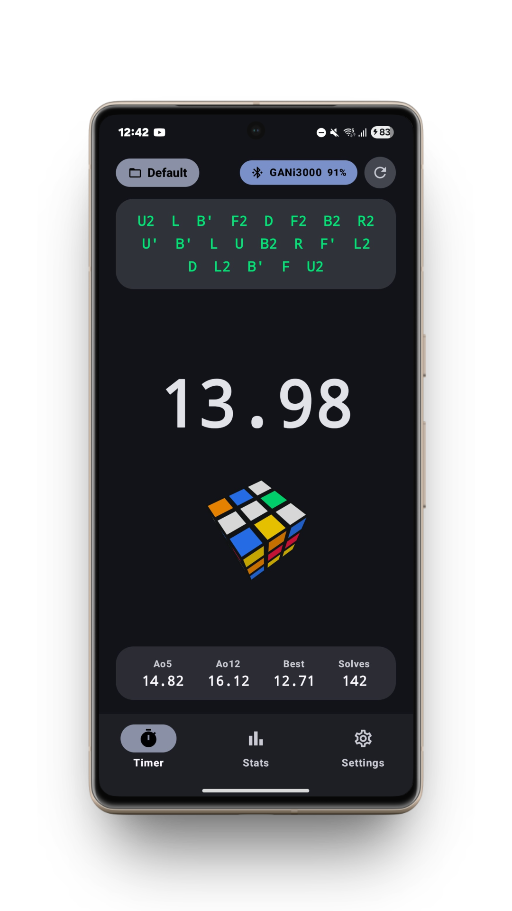
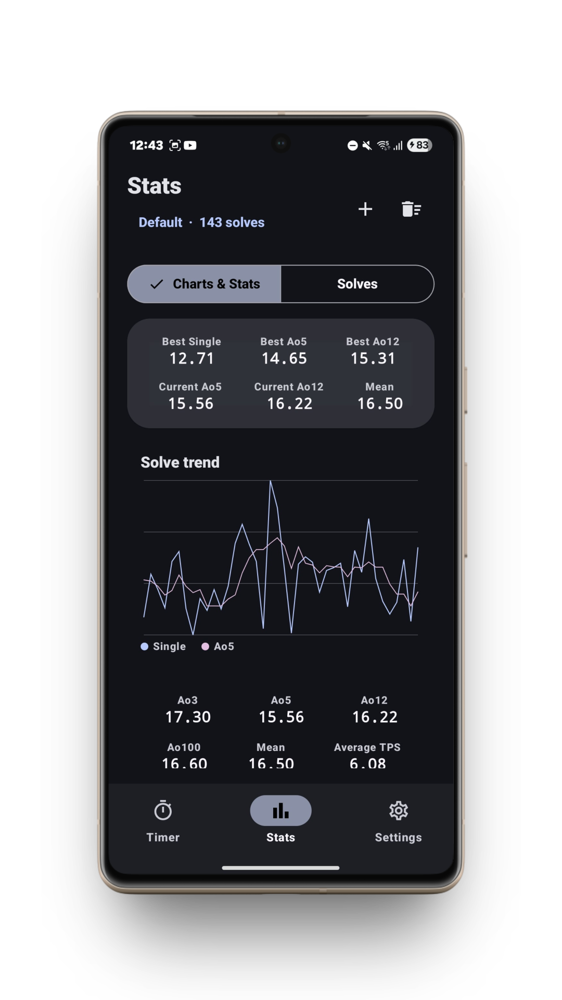
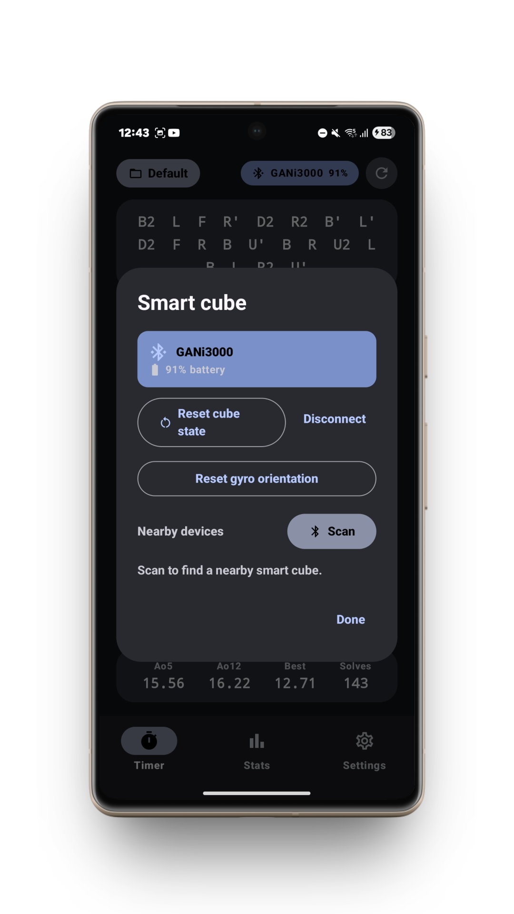
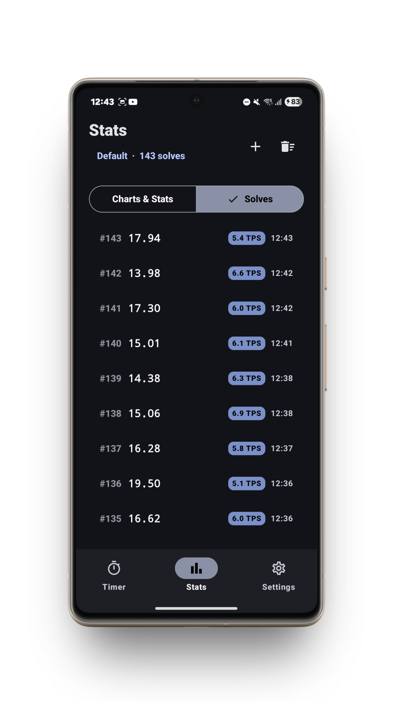
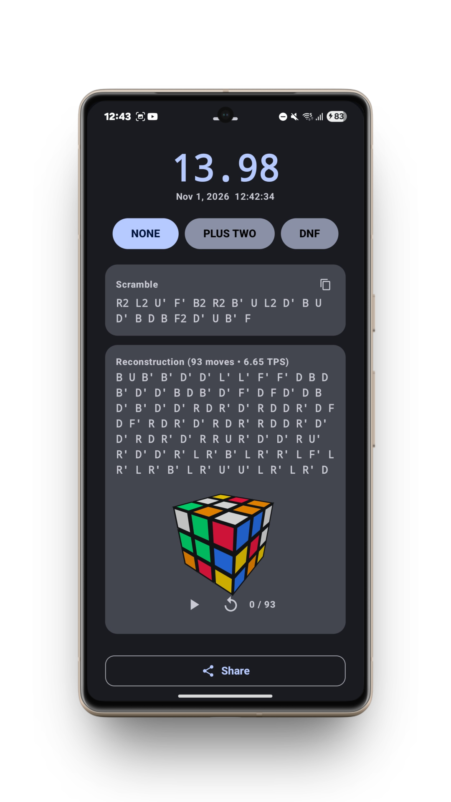

# Cubyy

Cubyy is an open-source speedcubing timer for Android, built with Kotlin, Jetpack Compose, and Material 3. It combines touch timing, Bluetooth smart-cube support, the GAN Halo Timer, TNoodle scrambles, per-event sessions, detailed solve analysis, and csTimer-compatible backups.

[](https://developer.android.com)
[](https://www.gnu.org/licenses/gpl-3.0)
[](https://github.com/franekk3/cubyy-android/releases/latest)

## Highlights

- Time solves with the touchscreen, a supported Bluetooth smart cube, or a GAN Halo Timer.
- Generate official WCA-event scrambles with TNoodle and view their 2D diagrams.
- Keep sessions separate for each puzzle and browse solve history, reconstructions, and statistics.
- Import and export selected sessions using csTimer-compatible JSON backups.
- Use the responsive Material 3 interface on phones and tablets, in portrait or landscape.

## Timer and scrambles

### Timing methods

The touch timer uses a configurable hold-to-start delay (0.15–0.75 seconds, 0.3 seconds by default). The touch area spans the available timer space between the scramble and bottom navigation. WCA inspection can be enabled in Settings and is off by default. After a touch solve, the `+2`, `DNF`, and delete controls appear directly below the time. The penalty controls are mutually exclusive, and selecting the active penalty again clears it. Deleting the latest solve asks for confirmation.

The timer can hide its running digits and show “Solving…” instead. Supported smart cubes can start and stop solves automatically; the GAN Halo Timer reports its own timer state over Bluetooth. Smart-cube solves can retain move-by-move reconstruction data, while touch and Halo Timer solves use the same post-solve penalty choices.

### Puzzle events

TNoodle supplies scramble generation and 2D diagrams for the supported events:

- 2×2×2, 3×3×3, 4×4×4, 5×5×5, 6×6×6, and 7×7×7
- 3×3×3 One-Handed, 3×3×3 Blindfolded, 4×4×4 Blindfolded, and 5×5×5 Blindfolded
- Clock, Megaminx, Pyraminx, Skewb, and Square-1
- 3×3×3 Fewest Moves and 3×3×3 Multi-Blind
- Face-Turning Octahedron (FTO), available as a non-WCA event

Scramble notation is shown above the timer. Tap it to copy the full scramble. On phones, long scrambles can be scrolled; when they exceed the compact preview, an expand button opens a full-screen view. The 2D scramble image is shown alongside quick statistics where supported. It is hidden for smart-cube solves, where the virtual cube and move reconstruction are available instead.

Multi-Blind creates a configurable batch of 3×3 scrambles for one timed attempt. After stopping, enter the number solved to record the result.

## Bluetooth devices

Cubyy includes BLE protocol drivers for supported GAN smart cubes, GiiKER/Xiaomi smart cubes, MoYu smart cubes, and the GAN Halo Timer. The precise models and firmware combinations that work can vary; the app identifies devices through its Bluetooth device picker. Android may request Bluetooth scan and connect permissions when scanning.

Smart-cube support is for 3×3×3 hardware. When a smart cube is connected, event selection is restricted to 3×3×3. Connecting the GAN Halo Timer does not restrict event selection.

For supported cubes, Cubyy can display a 3D virtual cube, compare scramble progress with detected turns, help recover from scramble setup mistakes, and record move count and TPS. The virtual cube supports classic and stickerless appearances and can be rotated to inspect the solve. The GAN Halo Timer view uses its own timer graphic and does not display cube-only reconstruction or TPS data.

## Sessions, history, and statistics

Sessions belong to a puzzle event, so similarly named sessions for different puzzles keep separate solves. Cubyy creates a `Default` session for each supported event. The event and session picker lets you change puzzles, select an existing session, or create a new one. A connected smart cube keeps the picker on 3×3×3 sessions.

Solve history stores the time, penalty, scramble, and date, plus reconstruction data when a smart cube supplied it. Solve details include a TNoodle 2D scramble diagram; smart-cube solves can switch between that diagram and the 3D move reconstruction. Users can edit penalties, delete solves, and share solve details.

Statistics include session mean, best and worst single, current and best Ao5/Ao12, Ao3, Ao100, Ao500, Ao1000, total solve time, and average TPS when move data is available. The solve activity chart groups attempts by date; selecting a day displays its solve count and summed solve time. Timer-screen quick stats adapt to available screen height, and scramble diagrams scale for phones and tablets.

## Import and export

Export opens a session selector listing only sessions that contain solves. Each entry includes its puzzle, session name, and solve count, and supports selecting or clearing all entries. The resulting JSON includes event identifiers so different puzzles with the same session name remain distinct.

Import accepts Cubyy and csTimer-compatible JSON backups, maps known event identifiers, and restores solves into their matching puzzle sessions. Existing solves are checked to avoid importing duplicates. Keep a copy of important timer data before moving between apps or devices.

## Appearance and settings

- Material 3 dynamic colors from the system wallpaper, or blue, green, yellow, and red color palettes.
- Light, dark, or system-controlled appearance.
- Classic or stickerless 3D cube model, adjustable virtual cube size, and scramble text size.
- Optional hidden running time, touch hold duration, and optional WCA inspection.
- Adaptive layouts for phone, tablet, portrait, and landscape screens.
- Project GitHub link and GAN Halo Timer support information in Settings.

## Screenshots

<p align="center">
  
  
  
  
  
</p>

## Build

Open the repository in Android Studio, or build a debug APK from the project root:

```bash
./gradlew assembleDebug
```

The APK is written to `app/build/outputs/apk/debug/app-debug.apk`.

## License

Cubyy is licensed under the [GNU General Public License v3.0](LICENSE). Third-party libraries retain their respective licenses.
